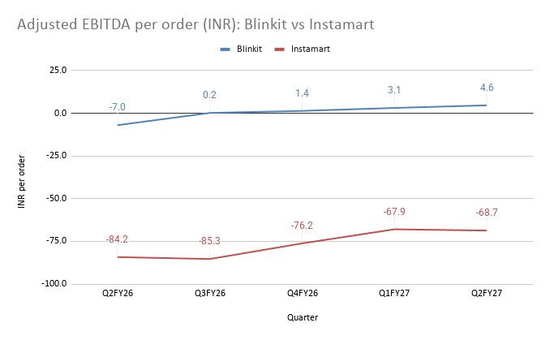
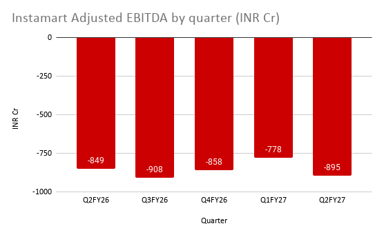
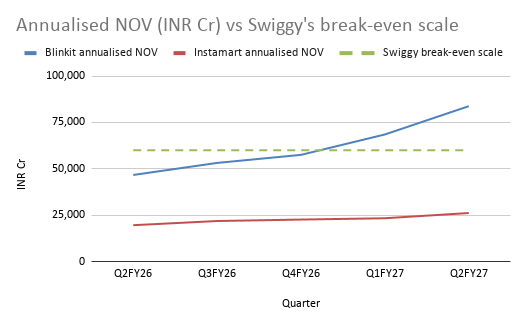

# Case 2: Is quick commerce profitable yet? Blinkit vs Instamart

Independent analysis using public data. Not affiliated with or endorsed by Eternal or Swiggy.

## 1. The question
Blinkit (Eternal) has turned profitable at the Adjusted EBITDA level. Instamart (Swiggy) is still losing about INR 900 Cr a quarter.
How far apart are their unit economics, and is Swiggy's own break-even guidance realistic?

1. How do per-order economics compare?
2. Did Instamart's losses "peak" in Q2FY27?
3. Is Swiggy's INR 60,000 Cr break-even scale consistent with Blinkit's own path to profit?

## 2. The data
Official quarterly shareholder letters from Eternal (21 Oct 2026) and Swiggy (22 Oct 2026). Five quarters, Q2FY26 to Q2FY27, compiled by hand and checked against the PDFs.
Dataset: `data/clean/quick_commerce_dataset.xlsx` (includes a Definitions sheet and self-check rows). Sources and terms: `docs/data_sources.md`.

## 3. The analysis
- Compiled quick-commerce metrics for both brands and cross-checked them (recomputed average order value, margins and segment totals).
- Compared like with like: used per-order measures and net order value. Revenue was not compared because Blinkit includes the value of goods sold and Instamart reports marketplace revenue.
- Per order maths: INR Cr x 10 / million orders = INR per order.
- Tested three claims with three charts (drawn in Google Sheets; chart 1 also rebuilt in Excel).
- Summarised the data with an Excel PivotTable and cross-checked key figures with VLOOKUP and XLOOKUP (see the Pivot and Lookup sheets in the workbook).

## 4. What we found

### Finding 1: Per-order economics diverge

Blinkit's Adjusted EBITDA per order moved from about -INR 7 in Q2FY26 to about +INR 4.6 in Q2FY27, crossing into profit in Q3FY26. Instamart improved from about -INR 84 to about -INR 69 over the same period. The gap in Q2FY27 is roughly INR 73 per order. (Blinkit's order count includes cancelled orders, so its per-order profit is slightly understated.)

### Finding 2: "Peaked" depends on how you measure it

Instamart's largest quarterly Adjusted EBITDA loss in this window was Q3FY26 (-INR 908 Cr). Q2FY27 (-INR 895 Cr) is the second largest and up from -INR 778 Cr in Q1FY27, as orders grew about 14% quarter on quarter. Relative to size, losses have improved steadily: from -12.1% of GOV in Q2FY26 to -9.7% in Q2FY27, and from about -INR 84 to -INR 69 per order. "Peaked" is therefore defensible only in a relative sense; in absolute rupees, a lower loss in Q3FY27 would be needed to confirm it. Swiggy guides to roughly 100 bps better Adjusted EBITDA margin in Q3FY27 (about -8.7% of GOV), which gives a testable marker for next quarter.

### Finding 3: Swiggy's break-even target is in line with Blinkit's path, but scale alone is not enough

Swiggy's break-even markers (annualised NOV of about INR 60,000 Cr and contribution of about INR 30 per order) are close to where Blinkit stood when its Adjusted EBITDA first turned positive in Q3FY26 (annualised NOV about INR 53,200 Cr; contribution about INR 30 per order). Instamart's annualised NOV is about INR 26,000 Cr (about 44% of the way) and its derived contribution is about -INR 7 per order. Instamart must grow roughly 2.3x and lift contribution per order by about INR 37. Contribution is defined differently by each company and Instamart's figures are derived from rounded percentages, so this comparison is indicative.

## 5. What the companies could do, and what to watch
1. **Make "peak" testable.** Report loss per order and loss as a % of GOV next to absolute losses, so progress is clear even when growth temporarily raises the rupee loss.
2. **Focus on contribution per order.** Swiggy says about two-thirds of the gap closes through revenue per order (product mix, own brands, advertising) and one-third through lower cost per order. Track those levers quarterly.
3. **Watch the inventory-model transition.** Swiggy plans to move Instamart to an inventory model from mid-Q3FY27. That will change how revenue is reported, so compare future quarters on NOV and per-order measures, not revenue.
4. **Update with Q3FY27 results** (expected around late January 2027) to test the 100 bps guidance.

## Limitations
- Blinkit's order count includes cancelled orders; Instamart's is completed orders only.
- Revenue is not comparable between the two.
- Contribution and Adjusted EBITDA are each company's own definitions, and shared costs are allocated differently.
- Instamart's NOV and contribution in INR Cr are derived from rounded percentages.
- Only five quarters are covered, from one letter per company.

## Files
- `data/clean/quick_commerce_dataset.xlsx`: dataset, checks, definitions, chart data, PivotTable and lookup practice
- `outputs/`: the three charts